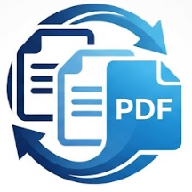

# PDF Merger

Windows 桌面文件合并工具，使用 **C++17 + Win32**。选择本机 PDF、Word、Excel 和图片，按列表顺序转换并合并成一个 PDF。

## 普通用户使用

推荐下载 `PDF-Merger-Setup-windows-x64.exe`，双击后按向导操作：

1. 选择本工具的安装目录。
2. 配置 Word / Excel 支持：自动识别已安装的 LibreOffice（读取安装记录和已有配置），默认复用并跳过文件选择。未识别时只需选 LibreOffice 安装文件夹或 `program` 文件夹，无需翻找 EXE；也可下载安装或暂时跳过。
3. 如选择新安装，可单独设置 LibreOffice 安装目录。选择已有文件的文件夹时，向导自动补上 `LibreOffice` 子目录，重名时自动编号；无需先创建目录。最终路径会显示在安装前的确认页。向导下载官方 MSI，并校验固定 SHA-256。
4. 选择是否创建桌面快捷方式，完成安装后启动。

PDF 引擎及其 DLL 已内置，无需配置 PATH。LibreOffice 路径保存在应用目录的 `settings.ini`，
不修改系统 PATH。支持开始菜单启动和 Windows“已安装的应用”卸载。
安装器需要管理员权限；首次下载安装 LibreOffice 需要网络和数百 MB 流量。
已有 LibreOffice 时请选择“使用已安装的 LibreOffice”，避免更改已有部署。
LibreOffice 是独立安装的软件，卸载本工具不会卸载它。
静默安装默认跳过 LibreOffice 下载；完整配置请使用交互式向导。

也可使用便携版：

1. 解压完整的 `PDF-Merger-windows-x64.zip`，不要只拷贝其中的 EXE。
2. 双击 `OrderedPdfMerger.exe`。
3. 点击“添加文件”，或从资源管理器拖入文件。允许分批添加。
4. 检查顺序。选中文件，用“上移 / 下移”调整；也可移除或清空。
5. 点击“合并并保留 PDF”。程序先生成并保留“最近合并.pdf”，不再要求当场选择保存位置。
6. 点击界面中的文档路径可直接打开；也可“另存为…”复制到其他位置，或“删除”最近文档。

最近文档优先保存在程序目录。目录不可写时，自动保存在 `%LOCALAPPDATA%\PDF Merger`，不修改权限或系统设置。重新打开程序后仍可访问；卸载程序时保留用户生成的 PDF。

Windows 多选框和拖放接口返回的文件顺序**不保证是鼠标点击顺序**。程序保留接口返回的
顺序，不按名称自行排序。**主窗口列表才是最终合并顺序**；若要求精确的添加顺序，可逐个
添加或添加后调整。文件内部所有页面保持连续。

支持 Windows 10 / 11 x64。输入最多 100 个文件，总大小 200 MB。

项目自身代码采用 [MIT License](LICENSE)。依赖保留各自许可，见
[THIRD_PARTY_NOTICES.md](THIRD_PARTY_NOTICES.md)。
